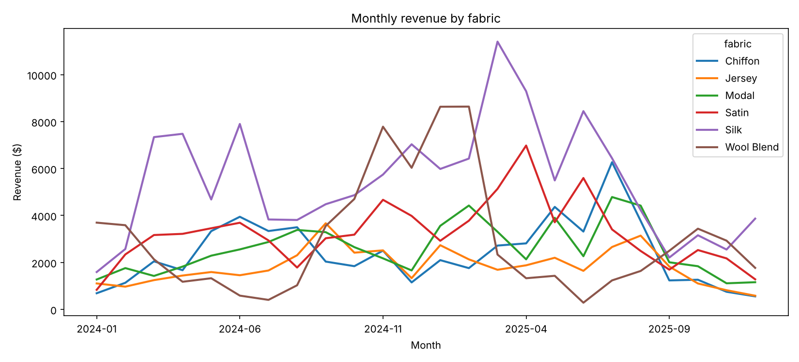
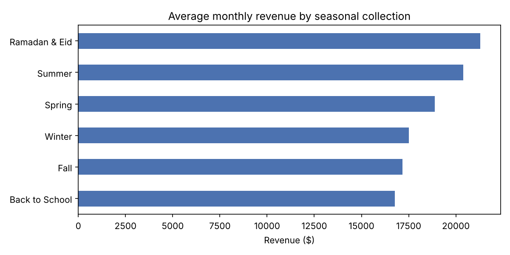
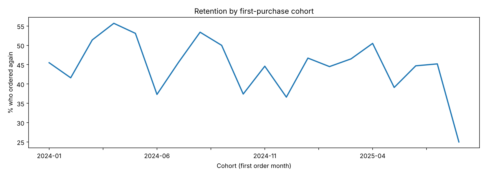

# VeilIQ: Hijab Retail Analytics

SQL and Python analysis of hijab retail transactions: which fabrics and colours drive sales, how demand shifts across seasonal collections like Ramadan and Eid, which styles lead each fabric, and how well the business keeps customers coming back.

## Questions this project answers

1. **Which fabrics drive revenue?** Revenue and share of total by fabric.
2. **How seasonal is demand?** Monthly revenue per fabric, with month-over-month change.
3. **What are the best-selling styles?** Top 3 colours within each fabric.
4. **Which colours sell most?** Units and revenue by colour, ranked.
5. **Which seasonal collections perform best?** Average monthly revenue and order value per collection.
6. **Do customers come back?** Repeat purchase rate and retention by first-purchase cohort.
7. **Who are the most valuable customers?** Customers split into spend quartiles.

## SQL techniques used

| Technique | Where |
| --- | --- |
| Multi-table `JOIN`s | Every query joins orders, order items, and products |
| CTEs (`WITH`) | Seasonal trend, top styles, collections, retention, value tiers |
| `LAG()` window function | Month-over-month revenue change per fabric |
| `RANK()` window function | Top styles within each fabric, colour ranking |
| `NTILE()` window function | Customer spend quartiles |
| `SUM() OVER ()` | Each fabric's share of total revenue |

## Project structure

```
data/generate_data.py   builds the dataset (customers, products, orders, order_items)
sql/schema.sql          PostgreSQL schema with keys, constraints, and indexes
sql/analysis.sql        all analysis queries, one per question
analysis.py             runs the queries with pandas and saves tables + charts
outputs/                query results (CSV) and charts (PNG)
```

## How to run

```bash
pip install -r requirements.txt
python data/generate_data.py   # creates the CSVs in data/
python analysis.py             # runs every query, saves results and charts to outputs/
```

By default this loads the data into SQLite so it runs anywhere. To run against PostgreSQL:

```bash
createdb veiliq
psql veiliq -f sql/schema.sql
psql veiliq -c "\copy customers FROM 'data/customers.csv' CSV HEADER"
psql veiliq -c "\copy products FROM 'data/products.csv' CSV HEADER"
psql veiliq -c "\copy orders FROM 'data/orders.csv' CSV HEADER"
psql veiliq -c "\copy order_items FROM 'data/order_items.csv' CSV HEADER"
DATABASE_URL=postgresql://localhost/veiliq python analysis.py
```

## About the data

The dataset is synthetic, generated by `data/generate_data.py` with realistic patterns: 48 styles across 6 fabrics and 8 colours, seasonal demand (chiffon in summer, wool blends in winter, silk and satin before Eid), discounts, and a mix of loyal and one-time customers who churn over time. It covers 2,000 customers and two years of orders (2024 to 2025).

## Key findings

_Fill these in from `outputs/` after running the analysis._

- Top fabric by revenue:
- Best-selling colour:
- Strongest seasonal collection:
- Repeat purchase rate:
- Revenue share from the top 25% of customers:

## Charts




